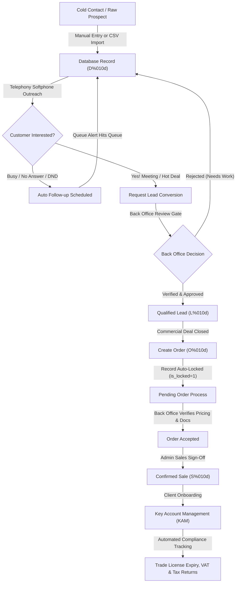

<div align="center">

# Seven Strokes CRM (v2)

### The no-nonsense commercial ops, softphone dialer & key account management powerhouse.

[](https://www.php.net/)
[](https://codeigniter.com/)
[](https://www.mysql.com/)
[](#copyright--can-you-claim-this-crm)
[](#design-vibe--apple-style-rules)
[](#cpanel-hosting-guide-step-by-step)

<br/>

**Seven Strokes CRM** is an all-in-one operations platform built for fast-moving sales reps, back office gatekeepers, key account managers (KAM), and executives. 

Old CRMs usually feel like using software from 2004—bulky boxes, neon rainbow buttons, and loading spinners that take forever. We scrapped all that bloat. This CRM looks like a clean Apple desktop app, runs buttery smooth on any regular cPanel hosting, dials prospects straight from your browser, and keeps raw leads strictly separated from approved money-making sales.

</div>

---

## Quick Navigation

- [Current State (2026-11-04)](#current-state-2026-11-04)
- [Why We Built This (The Real Story)](#why-we-built-this-the-real-story)
- [System Architecture & Workflow](#system-architecture--workflow)
- [How Much Code Actually Changed? (Stats)](#how-much-code-actually-changed-stats)
- [Feature Breakdown: What's In The Box](#feature-breakdown-whats-in-the-box)
- [Tech Stack](#tech-stack-what-this-project-really-uses)
- [1. Local Setup](#1-local-setup-step-by-step)
- [2. Environment Variables and Config Files](#2-environment-variables-and-config-files)
- [3. Database Migrations](#3-database-migrations)
- [4. Deploy on cPanel](#4-deploy-on-cpanel-shared-hosting)
- [5. Netlify: Can This CRM Run There?](#5-netlify-can-this-crm-run-there)
- [6. Deploy on AWS](#6-deploy-on-aws)
- [7. Troubleshooting](#7-troubleshooting)
- [Password reset email setup](#26-password-reset-emails-smtp-setup)
- [Support page and Live Support](#27-support-page-and-live-support-chat)
- [Copyright: Can You Claim This CRM?](#copyright--can-you-claim-this-crm)

---

## Current State (2026-11-04)

Read [`audit today's state.md`](audit%20today's%20state.md) before starting new work. It lists what works, what is a placeholder, what is broken, and the security fixes needed, as a prioritized task list.

Key points:

- **Security first**: the database dump `database/localhost.sql` is tracked in git and must be removed from the repo and its history; several endpoints need login checks; passwords use unsalted SHA-1. See audit section 3 (P0 items).
- **Known broken**: the 3CX CDR / recording webhooks (blocked by the login check). My Zone > View Leads was fixed on 2026-11-04.
- **Navigation**: the top navigation bar is kept on purpose. A sidebar is planned for a later phase.
- **Dashboard**: keeps its approved original colors. The Ocean Blue theme (`assets/dist/css/crm-theme.css`) applies to every other page and skips `.full-screen-dash`.

New in this release:

- Ocean Blue theme layer, redesigned Login / Forgot / Reset password pages.
- Add Database and View Database edit: Manual Dialer fields first, all other fields in Additional Details.
- Dialer campaigns (create, view, filters, participants, progress), custom dialing range with resume and skip-called options, single-card Manual Dialer.
- Back Office Add Follow-Up as a full page, Open Orders table matching View Database.
- Profile page opens from the avatar; attendance, shifts, leave and events use real data.

Local development: run `php -S localhost:8091 router.php` from the project root, or `.claude/dev-server.ps1` in the worktree, which restarts the server automatically.

---
## Why We Built This (The Real Story)

Most legacy CRMs have two massive headaches:
1. **Sales reps mess up client data**: A rep edits a client name mid-order, changes the price on a whim, or marks a cold lead as "Sale Won" before anyone verified payment. Pure chaos.
2. **Servers crawl on their knees**: The old database was doing over **400 unindexed SQL queries** just to render the dashboard once. On shared cPanel hosting, that felt like dial-up internet.

We fixed both:
- **Strict Entity Separation**: A record starts as a cold Database row (`D0000000001`). Once verified, it becomes a Lead (`L0000000001`). Once an order is submitted, the record gets **locked immediately** (`is_locked=1`) so reps can't alter prices behind your back. Only Back Office and Admins can approve it into a confirmed Sale (`S0000000001`).
- **Performance That Hits Different**: Added composite indexes on every heavy foreign key, cached team lookups in memory, and throttled session writes. The dashboard now loads instantly without melting your server CPU.

---

## System Architecture & Workflow

Here is the exact lifecycle of how data flows through Seven Strokes CRM—from cold calling to renewal contracts:



---

## How Much Code Actually Changed? (Stats)

We didn't just tweak a few colors. We overhauled the entire codebase from the ground up compared to the initial legacy base commit (`d5d67fd`):

```
========================================================================================
SEVEN STROKES CRM - QUANTITATIVE EVOLUTION AUDIT
Baseline: Initial Commit (d5d67fd)  -->  Current Enterprise v2 (HEAD)
========================================================================================
Files Created / Updated      : 177 files
Total Added Lines            : +91,267 lines
Total Removed Lines          : -6,987 lines
----------------------------------------------------------------------------------------
NET CODE ADDED               : +84,280 lines
Total Added Words            : +641,059 words
Total Removed Words          : -18,212 words
----------------------------------------------------------------------------------------
NET WORDS ADDED              : +622,847 words
Total Added Characters       : +5,690,960 chars
Total Removed Characters     : -255,270 chars
----------------------------------------------------------------------------------------
NET CHARACTERS ADDED         : +5,435,690 chars
Total Alphabets (Letters)    : +2,655,328 letters (+2,782,220 inserted / -126,892 removed)
========================================================================================
```

---

## Feature Breakdown: What's In The Box

### 1. Executive Dashboard (No Clutter, All Signal)
- **Top 8 KPI Cards**: Instant counts for My Database, My Verticals, Team Users, Team Verticals, Leads, and Orders styled in Royal Blue (`#0072f0`). The whole card is clickable.
- **12-Month Projections**: Clean line charts showing Target vs Achievement and Target vs Projection across a full 12-month rolling window.
- **Apple-Style Donut Charts**: Crisp, high-res SVG circular charts for **My Leads** and **My Orders**. Big bold donut rings (220px diameter, 110px outer radius, 68px inner cutout), high-contrast status percentages on hover, and clear outside text labels showing status names and exact counts (e.g., `Busy: 0`, `DNCR: 0`).
- **Operational Activity Grid**: Live cards for tickets, tasks, follow-ups, and meetings.

### 2. My Zone (Your Daily Grind)
- **Add & View Database**: Quick prospect entry with dual-box table filtering.
- **View Leads**: Pipeline status view for verified leads.
- **View Orders (`manager/orders/my`)**: View-only personal order tracker. No sneaky post-submission editing.
- **View Sales**: Verified revenue wins.
- **My Follow-ups & Meetings**: Smart calendar tracking today's calls, missed follow-ups, and future bookings.

### 3. Team Management & Org Chart
- **Interactive Tree Hierarchy**: Sleek tree diagram letting team leaders drill up to their direct manager or expand downwards into sub-teams with smooth zoom controls.
- **Team Activity Tracker**: Live feed of what your sales reps are actually doing (leads worked, calls logged, deals closed).
- **Database Bulk Assignment**: Rebalance lead distribution across sales reps with one click.

### 4. Back Office Gatekeeper
- **Pending Leads Approval (`manager/leads/review_leads`)**: Quality gate to make sure reps only promote legitimate, verified prospects to Leads.
- **Pending Order Process (`manager/orders/pending_process`)**: Finance and ops audit trade licenses, pricing, and contract documents before orders go live.
- **Onboard Client (`manager/kam/onboard`)**: Smooth handoff to account managers with corporate legal profiles, Emirates, and jurisdiction details.

### 5. WebRTC Phone Dialer & Telephony
- **Cross-Device Ready**: Adapts smoothly from mobile touchscreens to desktop widescreen monitors.
- **4-Stage Smart Calling Queues**:
  1. Last 7 Days (Missed/Overdue)
  2. Today (Active targets)
  3. Next 7 Days (Upcoming bookings)
  4. All Future
- **Real Call Durations**: Zero fake connected timers. Timers only tick when the call is genuinely connected. Includes instant call note saving and optional Groq AI call summaries.

### 6. Live Operations Pivot Board
- **Spreadsheet-Style Pivot Sheet**: Compact table showing My Stats, Team Stats, and Leaderboards.
- **Color Coded Windows**: Today (Emerald), Last 7 Days (Amber), This Month (Blue), This Quarter (Purple).
- **Background Sync**: Silently fetches live stats every 10 seconds without annoying page refreshes.
- **TV Presentation Mode**: Dedicated full-screen layout designed for sales floor TV displays.

### 7. Key Account Management (KAM)
- Track trade license renewal dates, corporate tax filing deadlines, and VAT submission schedules so you never get hit with government fines.

### 8. HR Operations & GPS Geofencing
- Staff attendance tracking with GPS geofenced check-in boundaries, leave management, shift allocations, and payroll logs.

---

## Tech Stack (What This Project Really Uses)

| Part | What is used | Where |
|---|---|---|
| Language | PHP (tested on PHP 8.2.33). Works on PHP 8.1 and 8.2. PHP 8.3+ is not tested. | everywhere |
| Framework | CodeIgniter **2.2.6**, patched locally to run on PHP 8 (for example a `group_start()` shim in the database driver). | `system/` |
| Database | MySQL 5.7 / 8.0 or MariaDB 10.4+ through the `mysqli` driver | `application/config/database.php` |
| Web server | Apache with `mod_rewrite` (uses `.htaccess`). For local work the PHP built-in server with `router.php` also works. | `.htaccess`, `router.php` |
| Front end | Server-rendered PHP views, jQuery 2.2.3, Bootstrap 3, AdminLTE, Chart.js 1.x, DataTables, Select2 (all bundled in `assets/`) | `application/views/`, `assets/` |
| Email | PHPMailer (bundled) | `application/libraries/phpmailer/`, `application/models/mail_model.php` |
| Optional services | Groq (AI transcription and summaries), 3CX (calling), WhatsApp Cloud API, SMTP | `application/libraries/Groq_service.php`, `application/libraries/Threecx.php`, `application/controllers/ci_api.php` |

There is **no Composer and no npm build**. All PHP and JavaScript libraries are already inside the repository. Google Fonts and a few DataTables files load from public CDNs.

Required PHP extensions:

| Extension | Why |
|---|---|
| `mysqli` | database connection |
| `curl` | Groq, 3CX and WhatsApp API calls, integration connection tests |
| `mbstring` | text handling |
| `openssl` | HTTPS calls and SMTP TLS |
| `json` | AJAX responses (built in on PHP 8) |
| `session` | login sessions (built in) |

Check what you have:

```bash
php -v
php -m
```

---

## 1. Local Setup (Step by Step)

### 1.1 Install the tools

- **Git**
- **PHP 8.2** with the extensions listed above
- **MySQL or MariaDB**. The easiest option on Windows is **XAMPP** (includes Apache, MariaDB and phpMyAdmin). On macOS you can use MAMP or Homebrew. On Linux use your package manager.

### 1.2 Get the code

```bash
git clone https://github.com/Reinhart-py/crmV2.git
cd crmV2
```

### 1.3 Create the database

Create an empty database named `crm7strokes` (any name works, but then change `DB_NAME`).

Using the MySQL command line:

```bash
mysql -u root -p -e "CREATE DATABASE crm7strokes CHARACTER SET utf8mb4 COLLATE utf8mb4_unicode_ci;"
```

Or in phpMyAdmin: **Databases > Create database > `crm7strokes`**.

### 1.4 Import the base data

The repository has a full SQL file at `database/localhost.sql` (about 3.4 MB, 51 tables).

```bash
mysql -u root -p crm7strokes < database/localhost.sql
```

Or in phpMyAdmin: select `crm7strokes` > **Import** > choose `database/localhost.sql` > **Go**.

> Warning: this file currently contains real CRM data. Do not share it. The audit (SEC-1) asks to replace it with a schema-only file. Treat every account in it as compromised until passwords are reset.

### 1.5 Create the `.env` file

```bash
cp .env.example .env
```

On Windows PowerShell:

```powershell
Copy-Item .env.example .env
```

Edit `.env` for local work:

```env
DB_HOST=localhost
DB_NAME=crm7strokes
DB_USER=root
DB_PASS=
BASE_URL=http://localhost:8080/
CI_ENV=development
```

All variables are explained in section 2.

### 1.6 Run the database migrations

```bash
php migration_runner.php status
php migration_runner.php
```

### 1.7 Start the app

Option A, PHP built-in server (no Apache needed). Run this in the project root:

```bash
php -S localhost:8080 router.php
```

Open http://localhost:8080/

Option B, XAMPP Apache: put the project in `C:\xampp\htdocs\crmV2`, make sure `mod_rewrite` is on and `AllowOverride All` is set for `htdocs`, set `BASE_URL=http://localhost/crmV2/`, then open http://localhost/crmV2/

> Note: `.htaccess` uses `RewriteBase /`. If you serve the CRM from a sub folder like `/crmV2/`, change it to `RewriteBase /crmV2/`.

### 1.8 Log in

There is no default admin account. Users come from the `ci_user` table in the imported data. The login field is the `c_username` column and passwords are stored as SHA-1 hashes (the audit asks to change this to `password_hash`).

To set a known password for an existing admin user on your local copy:

```sql
SELECT id, c_username, name, user_type FROM ci_user WHERE user_type = 1 AND status = 1;
UPDATE ci_user SET c_password = SHA1('ChangeMe-Local-Only-123') WHERE c_username = 'the_admin_username';
```

Role IDs (`ci_user.user_type`): `1` Admin, `2` Back Office, `3` Salesperson, `4` KAM, `5` Presentation.

Logging in from a second browser logs out the first one (single active session), and the session ends after 5 minutes without activity.

---

## 2. Environment Variables and Config Files

### 2.1 How `.env` is loaded

- The file must be in the project root, next to `index.php`: `crmV2/.env`.
- It is read by `index.php` and again by `application/config/database.php`. Each line is `KEY=value`. Lines starting with `#` are comments. Quotes around values are removed.
- A value that already exists as a real server environment variable (for example set by Apache `SetEnv` or the hosting panel) wins over `.env`.
- `.env` is listed in `.gitignore`. Never commit it.

### 2.2 All variables the code reads

| Variable | Used for | Default if empty | Read in |
|---|---|---|---|
| `DB_HOST` (or `DB_HOSTNAME`) | Database server | `127.0.0.1` | `application/config/database.php` |
| `DB_USER` (or `DB_USERNAME`) | Database user | `root` on localhost, otherwise `crm7strokes` | `application/config/database.php` |
| `DB_PASS` (or `DB_PASSWORD`) | Database password | empty | `application/config/database.php` |
| `DB_NAME` (or `DB_DATABASE`) | Database name | `crm7strokes` | `application/config/database.php` |
| `BASE_URL` | Full site URL with a trailing slash, used for every link and asset | detected from the request host | `application/config/config.php` |
| `CI_ENV` | `development` shows PHP errors, `production` hides them | `development` on localhost, otherwise `production` | `index.php` |
| `MIGRATION_KEY` | Secret for running `migration_runner.php` from a browser | `crm7strokes_migrate` (change it, see audit SEC-15) | `migration_runner.php` |
| `GROQ_API_KEY` | Groq AI key for call transcription and summaries | value saved in System > Integrations | `application/libraries/Groq_service.php` |
| `GROQ_TRANSCRIPTION_MODEL` | Groq speech-to-text model | `whisper-large-v3-turbo` | `application/libraries/Groq_service.php` |
| `GROQ_CHAT_MODEL` / `GROQ_SUMMARY_MODEL` | Groq model for call summaries | `openai/gpt-oss-20b` | `application/libraries/Groq_service.php` |
| `THREECX_PBX_FQDN` | 3CX PBX host name | default only; `application/config/3cx_config.json` overrides it | `application/libraries/Threecx.php` |
| `THREECX_CLIENT_ID` | 3CX API client ID | default only; `application/config/3cx_config.json` overrides it | `application/libraries/Threecx.php` |
| `THREECX_CLIENT_SECRET` | 3CX API client secret | default only; `application/config/3cx_config.json` overrides it | `application/libraries/Threecx.php` |
| `THREECX_EXTENSION` | Default 3CX extension | default only; `application/config/3cx_config.json` overrides it | `application/libraries/Threecx.php` |
| `SMTP_HOST`, `SMTP_PORT`, `SMTP_CRYPTO`, `SMTP_USER`, `SMTP_PASS`, `SMTP_FROM_EMAIL`, `SMTP_FROM_NAME` | Mail server for password reset and other emails (`SMTP_CRYPTO` is `tls`, `ssl` or `none`) | only used when System > Integrations SMTP is not enabled; see 2.6 | `application/models/mail_model.php` |

Not used by the code (safe to leave empty):

- `DB_PORT`: listed in `.env.example` but `database.php` does not read it. For a non-default port, add `$db['default']['port'] = 3307;` in `application/config/database.php`.
- `PBX_ENDPOINT`: listed in `.env.example` but nothing reads it. Use the `THREECX_*` variables instead.

Example production `.env` (dummy values):

```env
DB_HOST=localhost
DB_NAME=cpaneluser_crm7strokes
DB_USER=cpaneluser_crmadmin
DB_PASS=replace-with-a-strong-password
BASE_URL=https://crm.example.com/
CI_ENV=production
MIGRATION_KEY=replace-with-a-long-random-string
GROQ_API_KEY=
THREECX_PBX_FQDN=
THREECX_CLIENT_ID=
THREECX_CLIENT_SECRET=
THREECX_EXTENSION=
```

### 2.3 Settings saved in the database (admin screen)

Open **System > Integrations** (`/manager/system/integrations`) as an admin. Values are stored in the `ci_integration_settings` table:

| Service | Fields |
|---|---|
| Groq | API key, transcription model, summary model, fallback model, temperature |
| 3CX | API key / secret, endpoint, bearer token, webhook secret |
| Email SMTP | host, port, user, password, encryption, from email, from name |
| WhatsApp | API key (access token), phone number ID, WABA ID |
| Cron, Helpdesk | endpoint and key fields |

`GROQ_*` environment variables override the saved Groq values.

3CX click-to-call settings are saved separately from **System > Calling API** (`/manager/system/calling-api`) into `application/config/3cx_config.json`. Values in that file override the `THREECX_*` environment variables, which are only defaults. That file holds the 3CX client secret and is **tracked in git** (today it contains no secrets). Never commit it after entering real values, and make sure PHP can write to it on the server.

### 2.4 Settings written directly in code (change them by editing the file)

| Setting | File | Current value | What to do |
|---|---|---|---|
| Encryption key (also signs the session cookie) | `application/config/config.php` | `abcdef123456` | Replace with a long random string before going live (audit SEC-6, SEC-13). |
| Secure cookies | `application/config/config.php` | `cookie_secure = FALSE` | Set `TRUE` when the site runs on HTTPS. |
| Error log level | `application/config/config.php` | `log_threshold = 0` (off) | Set `1` (errors only) in production. Logs go to `application/logs/`. |
| Session lifetime cookie | `application/config/config.php` | `sess_expiration = 7200` | The 5 minute idle logout is separate, in `ci_admin_model::check_auth_timeout()` and `application/views/manager/elements/footer.php`. |
| CSRF | `application/config/config.php` | on, token `csrf_test_name` | Keep on. |
| Database debug output | `application/config/database.php` | `db_debug = TRUE` | Set `FALSE` in production (audit SEC-16). |
| Fallback SMTP mailbox | `application/models/mail_model.php` | old vendor mailbox `no-reply@storeyourcode.com` | Only used when neither Integrations SMTP nor `SMTP_*` in `.env` is set. Configure your own SMTP (section 2.6) and then remove this fallback (audit SEC-14). |
| Clean URLs base path | `.htaccess` | `RewriteBase /` | Change if the CRM is in a sub folder. |

### 2.5 Development vs production

| Item | Development | Production |
|---|---|---|
| `CI_ENV` | `development` | `production` |
| `BASE_URL` | `http://localhost:8080/` | `https://your-domain/` |
| `encryption_key` | any | long random value |
| `cookie_secure` | `FALSE` | `TRUE` |
| `db_debug` | `TRUE` | `FALSE` |
| `log_threshold` | `0` or `4` | `1` |
| `MIGRATION_KEY` | any | long random value, or run migrations by SSH only |

### 2.6 Password reset emails (SMTP setup)

**How it works:** on **Forgot Password?** the user enters their email address (their login username or the email on their profile). The CRM emails a **Reset Password** link that is valid for **15 minutes** and works once. The link opens **Set New Password**, and after saving the user signs in with the new password. It is a link, not an OTP code.

The CRM cannot deliver email by itself. It needs a mailbox on your mail server (SMTP). Do this once on the live server.

**Step 1. Create a sending mailbox** on the domain you send from, for example `noreply@7strokes.com`, in cPanel > Email Accounts, Microsoft 365 or Google Workspace. Note its password.

**Step 2. Get the SMTP details** for that mailbox:

| Provider | Host | Port | Encryption | Username |
|---|---|---|---|---|
| cPanel hosting | `mail.your-domain.com` (shown in cPanel > Email Accounts > Connect Devices) | 465 or 587 | SSL for 465, TLS for 587 | the full mailbox address |
| Microsoft 365 | `smtp.office365.com` | 587 | TLS | the full mailbox address (SMTP AUTH must be enabled for that mailbox in the Microsoft 365 admin center) |
| Google Workspace / Gmail | `smtp.gmail.com` | 587 | TLS | the full address, with an **App Password** (needs 2-step verification), not the normal password |

**Step 3. Enter them in the CRM.** Sign in as an admin, open **System > Integrations > Email & SMTP Configuration**, fill in Host, Port, Username, Password, Encryption, From Email (use the same mailbox as Username) and From Name, set **Status = Enabled**, and click **Save Settings**. To change other fields later, leave Password empty and the saved password is kept.

**Step 4. Send a test.** On the same screen, type your own address under **Send a test email** and click **Send Test Email**. The message shows whether it was sent, which server was used, and the exact error if it failed. Then check that it arrived (also look in spam).

**Step 5. Make sure mail is not marked as spam** (ask whoever manages the domain's DNS):
- SPF: the domain's SPF TXT record must include the mail server, for example `include:spf.protection.outlook.com` for Microsoft 365.
- DKIM: turn on DKIM signing for the domain in cPanel (Email Deliverability) or Microsoft 365.
- The **From Email** must be on that same domain. Sending as `noreply@7strokes.com` through another company's server is what sends mail to spam.

**Step 6. Check `BASE_URL`** in `.env` is the real site address (for example `https://crm.7strokes.com/`). The reset link is built from it.

**Each user needs an email address.** The link is sent to the email on the user's profile, or to their username if the username is an email address. Users with neither cannot reset by themselves; an admin must reset their password.

**Which settings are used** (first match wins):
1. System > Integrations > Email SMTP, when Status is Enabled and Host is filled in.
2. `SMTP_HOST`, `SMTP_PORT`, `SMTP_CRYPTO`, `SMTP_USER`, `SMTP_PASS`, `SMTP_FROM_EMAIL`, `SMTP_FROM_NAME` in `.env`.
3. The old built-in mailbox `no-reply@storeyourcode.com` from the previous vendor. It only exists so mail does not stop completely. Do not rely on it: mail from it is often filtered as spam.

**Logs:** every send is written to `application/logs/mail-YYYY-MM-DD.log` (`SENT` or `FAILED` with the server error), and each request appears in the admin activity log as `password_reset_request` / `password_reset`. Those log files are not committed to git.
### 2.7 Support page and Live Support chat

**For people who cannot sign in:** the **Support** button on the Sign In, Forgot Password and Set New Password pages opens `/support` (no login needed). The visitor enters name, phone number, email (optional) and the issue.

- **A support agent is available:** a live chat starts on the same page. Messages update every few seconds.
- **No agent is available:** the visitor sees "Support is not available right now" and the request is **emailed automatically to the IT team** (`it@7strokes.ae`), sent from the SMTP mailbox in section 2.6 (`noreply@7strokes.ae`). The email has the reference number (`SUP-00012`), name, phone, email, issue and the conversation, and Reply goes straight to the visitor when they gave an email.
- **An agent is available but nobody replies within 3 minutes:** the same email is sent to IT and the visitor is told.

**For the support team:** open the profile menu (top right) > **Live Support** (`/manager/live-support`). It is available to Admin and the Support role, and to anyone given the `live_support` permission.

1. Switch **Available for chats** on and keep the page open. Agents count as online only while this page is open (it checks in every 3 seconds; after 90 seconds without it they are offline). While Available, the 5 minute idle sign-out is paused.
2. New chats appear at the top with a sound and a browser notification (allow notifications when asked).
3. Click a chat, reply (Enter to send), and click **Close chat** when done. Chats already emailed to IT can still be picked up and answered here.
4. Switch to **Away** when you leave.

**Change the IT email address:** System > Integrations > Helpdesk, field **Support email**. If it is empty, `it@7strokes.ae` is used.

**Limits and data:** 5 requests per hour per IP address, a hidden anti-bot field, CSRF protection. Chats are stored in `ci_support_chats` and `ci_support_messages`, and agent status in `ci_support_agents`. The tables are created automatically the first time the page is opened. Timing values are constants at the top of `application/models/support_model.php`.
---

## 3. Database Migrations

Migrations live in `application/migrations/` and are tracked in the `schema_migrations` table.

```bash
php migration_runner.php status
php migration_runner.php
php migration_runner.php rollback
```

Without SSH you can open `https://your-domain/migration_runner.php?key=YOUR_MIGRATION_KEY` (add `&action=status` to only see the status). Set `MIGRATION_KEY` first; see audit SEC-15 about locking this down.

| Migration | What it does |
|---|---|
| `001_core_crm_schema.php` | Creates `ci_tasks`, `ci_admin_logs`, extended `ci_tickets` columns, business categories |
| `002_ticket_history_and_followups.php` | Ticket history audit logs and follow-up queues |
| `003_user_security_and_currency.php` | User session tokens, IP logs, online indicators, user currency |
| `004_lead_quote_and_trn.php` | Quotes, Corporate Tax TRN, VAT TRN, data sources, database categories |
| `005_finance_and_operations.php` | Invoices, payments, expenses, service delivery, attendance, leaves |
| `006_orders_and_sales_approval.php` | Order approval fields, sales conversion tracking, lead locking |
| `007_performance_indexes.php` | Indexes on `ci_leads`, `ci_user`, `ci_orders`, `ci_tasks`, `ci_tickets` |
| `008_pipeline_sales_ref_no.php` | Adds `ci_pipeline.sales_ref_no` (needed by Approve & Onboard) and fills it from existing Sales orders |

Some tables and columns are also created by the app at runtime the first time a page needs them (for example `ci_dialer_campaigns`, `ci_dialer_progress` and `ci_call_logs.campaign_id` when the Dialer opens). The audit (BUG-4) asks to move these into migrations.

---

## 4. Deploy on cPanel (Shared Hosting)

### 4.1 PHP version and limits
1. cPanel > **Software > MultiPHP Manager**: select the CRM domain and choose **PHP 8.2** (or 8.1). Click **Apply**.
2. cPanel > **Select PHP Version > Extensions** (name depends on the host): make sure `mysqli`, `curl`, `mbstring` and `openssl` are ticked.
3. cPanel > **MultiPHP INI Editor** for the CRM domain:
   - `memory_limit = 256M`
   - `max_input_vars = 5000` (the role permission matrix has hundreds of checkboxes; the default 1000 cuts saved permissions)
   - `upload_max_filesize = 64M`
   - `post_max_size = 64M`
   - `max_execution_time = 300`

### 4.2 Database
1. cPanel > **MySQL Databases** > create database `crm7strokes` (cPanel adds your prefix, for example `cpaneluser_crm7strokes`).
2. Create a user with a strong password.
3. **Add User To Database** > tick **ALL PRIVILEGES**.
4. phpMyAdmin > select the database > **Import** > `database/localhost.sql`.

### 4.3 Upload the code
The CRM has no `public/` folder. `index.php` is in the project root, so the **Document Root must point to the project root**.

- Main domain: upload into `public_html/`.
- Subdomain (recommended), for example `crm.example.com`: cPanel > **Domains** > create the subdomain and set its Document Root to `/home/cpaneluser/crm.example.com` (or `public_html/crm`), then upload there.

Ways to upload:
- **Git Version Control**: cPanel > **Git Version Control** > **Create** > clone URL `https://github.com/Reinhart-py/crmV2.git` > path = the Document Root.
- **File Manager**: zip the project, upload, right-click > **Extract**. In File Manager **Settings** tick **Show Hidden Files** so `.htaccess` and `.env` are visible.

### 4.4 `.env`
In the CRM root, copy `.env.example` to `.env` and fill in the cPanel values (see section 2.2 example). `DB_HOST` is almost always `localhost` on cPanel.

### 4.5 Migrations
- With **Terminal** in cPanel:
  ```bash
  cd ~/public_html
  php migration_runner.php
  ```
- Without Terminal: open `https://crm.example.com/migration_runner.php?key=YOUR_MIGRATION_KEY` once.

### 4.6 Folders and permissions
- Folders `755`, files `644`.
- These must be writable by PHP (`755`, or `775` if your host needs it):
  - `application/cache/`
  - `application/logs/`
  - `assets/uploads/avatars/`
  - `assets/uploads/recordings/`
  - `assets/uploads/tickets/`

  Create the upload folders if they do not exist (`assets/uploads/` is in `.gitignore`):
  ```bash
  mkdir -p assets/uploads/avatars assets/uploads/recordings assets/uploads/tickets
  ```
- `.env` should be `600` or `640`.

### 4.7 Protect private files (recommended, not in the repo yet)
Because the project root is also the web root, add these lines at the top of `.htaccess` so the database dump, notes and config cannot be downloaded (audit SEC-1):

```apache
<FilesMatch "\.(sql|md|env|log|example|ps1)$">
    Require all denied
</FilesMatch>
<FilesMatch "^(migration_runner\.php|router\.php)$">
    Require all denied
</FilesMatch>
RedirectMatch 403 ^/(application|system|database|knowledge|\.git|\.agent|\.claude)(/|$)
```

Remove `migration_runner.php` from the second block only when you need to run it from the browser.

### 4.8 HTTPS, cron, go live
1. cPanel > **SSL/TLS Status** > **Run AutoSSL**. Then **Domains** > turn on **Force HTTPS Redirect**.
2. Set `cookie_secure = TRUE`, a new `encryption_key` and `db_debug = FALSE` (section 2.4).
3. cPanel > **Cron Jobs** > every minute (`* * * * *`):
   ```bash
   /usr/local/bin/php /home/cpaneluser/public_html/index.php ci_cron run >/dev/null 2>&1
   ```
   Daily reminders and recurring tasks have their own methods if you want separate schedules:
   ```bash
   /usr/local/bin/php /home/cpaneluser/public_html/index.php ci_cron daily_schedule_reminders >/dev/null 2>&1
   /usr/local/bin/php /home/cpaneluser/public_html/index.php ci_cron recurrence_runner >/dev/null 2>&1
   ```
   Your home path is shown in the cPanel **General Information** sidebar.
4. Log in, open **System > Integrations**, and enter Groq / 3CX / WhatsApp / SMTP details if you use them.

---

## 5. Netlify: Can This CRM Run There?

**No, not as it is.** Netlify hosts static files and runs serverless functions in JavaScript/TypeScript or Go. It cannot run PHP, CodeIgniter, Apache `.htaccess` rules, PHP sessions, or a MySQL database. Every CRM page is built by PHP on the server, so there is no separate front end that could be moved to Netlify.

What is possible:

| Option | Works? | Notes |
|---|---|---|
| Whole CRM on Netlify | No | PHP is not supported. |
| Front end on Netlify, PHP back end elsewhere | Not without a rewrite | The views are PHP templates. You would first need to rebuild the UI as a separate JavaScript app that calls a JSON API, and build that API. |
| Netlify as a proxy in front of a PHP server | Possible but not recommended | A `_redirects` rule like `/* https://crm-backend.example.com/:splat 200` forwards every request to a real PHP server (cPanel or AWS). It adds a hop and gives no real benefit over pointing DNS straight to the PHP server. |
| A static marketing or status page on Netlify | Yes | Only for pages that do not need the CRM. |

Recommendation: host the CRM on cPanel (section 4) or AWS (section 6).

---

## 6. Deploy on AWS

### 6.1 Recommended setup

| Need | AWS service |
|---|---|
| Web server running PHP | **EC2** (Ubuntu 22.04 LTS, `t3.small` or bigger), or **Lightsail** for a simpler fixed-price server |
| Database | **RDS for MySQL 8.0** (or MariaDB) in a private subnet |
| Secrets | **Systems Manager Parameter Store** (SecureString) or **Secrets Manager** |
| Domain | **Route 53** |
| HTTPS | **Let's Encrypt (certbot)** on the EC2 server, or **ACM** certificate on an **Application Load Balancer** |
| Backups | RDS automated backups + **EBS snapshots** of the server disk, or sync `assets/uploads/` to **S3** |
| Logs and alerts | **CloudWatch** agent for Apache and PHP logs |

### 6.2 Create the server (EC2, Ubuntu 22.04)

Security group: allow `22` only from your IP, `80` and `443` from anywhere.

```bash
sudo apt update
sudo apt install -y software-properties-common git unzip
sudo add-apt-repository -y ppa:ondrej/php
sudo apt update
sudo apt install -y apache2 php8.2 libapache2-mod-php8.2 php8.2-mysql php8.2-curl php8.2-mbstring php8.2-xml
sudo a2enmod rewrite headers
sudo systemctl restart apache2
```

### 6.3 Put the code on the server

```bash
cd /var/www
sudo git clone https://github.com/Reinhart-py/crmV2.git crm
sudo chown -R www-data:www-data /var/www/crm
sudo mkdir -p /var/www/crm/assets/uploads/avatars /var/www/crm/assets/uploads/recordings /var/www/crm/assets/uploads/tickets
sudo chown -R www-data:www-data /var/www/crm/assets/uploads /var/www/crm/application/cache /var/www/crm/application/logs
```

Apache site file `/etc/apache2/sites-available/crm.conf`:

```apache
<VirtualHost *:80>
    ServerName crm.example.com
    DocumentRoot /var/www/crm
    <Directory /var/www/crm>
        AllowOverride All
        Require all granted
    </Directory>
    ErrorLog ${APACHE_LOG_DIR}/crm_error.log
    CustomLog ${APACHE_LOG_DIR}/crm_access.log combined
</VirtualHost>
```

```bash
sudo a2ensite crm.conf
sudo a2dissite 000-default.conf
sudo systemctl reload apache2
```

Also add the protection rules from section 4.7 to `.htaccess`.

### 6.4 Database (RDS)
1. RDS > **Create database** > MySQL 8.0 > private subnet > no public access.
2. Allow port `3306` in the RDS security group **only from the EC2 security group**.
3. From the EC2 server, create the database and import:
   ```bash
   sudo apt install -y mysql-client
   mysql -h your-rds-endpoint.rds.amazonaws.com -u admin -p -e "CREATE DATABASE crm7strokes CHARACTER SET utf8mb4 COLLATE utf8mb4_unicode_ci;"
   mysql -h your-rds-endpoint.rds.amazonaws.com -u admin -p crm7strokes < /var/www/crm/database/localhost.sql
   ```
4. Set `DB_HOST` to the RDS endpoint.

### 6.5 Environment variables and secrets
Store each secret in Parameter Store, for example `/crm/prod/DB_PASS` as a SecureString. On each deploy, write them into `/var/www/crm/.env`:

```bash
aws ssm get-parameter --name /crm/prod/DB_PASS --with-decryption --query Parameter.Value --output text
```

Or set them in the Apache site file (real environment variables win over `.env`):

```apache
SetEnv DB_HOST your-rds-endpoint.rds.amazonaws.com
SetEnv DB_NAME crm7strokes
SetEnv CI_ENV production
SetEnv BASE_URL https://crm.example.com/
```

Make `.env` private:

```bash
sudo chown www-data:www-data /var/www/crm/.env
sudo chmod 640 /var/www/crm/.env
```

Then run migrations:

```bash
cd /var/www/crm
sudo -u www-data php migration_runner.php
```

### 6.6 Domain and HTTPS
1. Route 53 > create an **A record** for `crm.example.com` pointing to the EC2 Elastic IP (or an alias to the load balancer).
2. HTTPS with certbot:
   ```bash
   sudo apt install -y certbot python3-certbot-apache
   sudo certbot --apache -d crm.example.com
   ```
3. Set `cookie_secure = TRUE` in `application/config/config.php`.

### 6.7 Cron

```bash
sudo crontab -u www-data -e
```

Add:

```
* * * * * /usr/bin/php /var/www/crm/index.php ci_cron run >/dev/null 2>&1
```

### 6.8 Files and backups
- Avatars, call recordings and ticket attachments are saved on the server disk in `assets/uploads/`. They are not in git. Back them up:
  ```bash
  aws s3 sync /var/www/crm/assets/uploads s3://your-backup-bucket/crm-uploads/
  ```
- Turn on RDS automated backups (7 to 35 days) and schedule EBS snapshots with **Data Lifecycle Manager**.

### 6.9 Production security checklist
- New `encryption_key`, `cookie_secure = TRUE`, `db_debug = FALSE`, `CI_ENV=production`.
- Block private files (section 4.7). Do not deploy `database/localhost.sql` to production servers.
- SSH only from your IP, database not public.
- Set up your own SMTP mailbox (section 2.6), then remove the old vendor fallback mailbox from `application/models/mail_model.php`.
- Work through the P0 list in `audit today's state.md`.

---

## 7. Troubleshooting

| Problem | Likely cause | Fix |
|---|---|---|
| `Unable to connect to your database server` | Wrong `DB_*` values, or MySQL is not running | Check `.env`. On cPanel the database and user names include your prefix (`cpaneluser_...`). Test with `mysql -h HOST -u USER -p DBNAME`. |
| `Unknown column ...` or `Table ... doesn't exist` | Database is older than the code | Run `php migration_runner.php`. Run migrations after every update. |
| Blank white page | PHP fatal error hidden in production | Set `CI_ENV=development` temporarily and reload, or read the error log (see below). |
| `404 Page Not Found` on every page except the home page | `mod_rewrite` off, `.htaccess` missing, or `AllowOverride None` | Upload `.htaccess`, run `sudo a2enmod rewrite`, set `AllowOverride All`. Check `RewriteBase`. |
| CSS and images missing, links go to the wrong domain | Wrong `BASE_URL` | Set `BASE_URL` to the exact site URL with a trailing slash. |
| `The action you have requested is not allowed.` | CSRF token expired or missing | Reload the page and submit again. Make sure custom forms include the CSRF hidden field. |
| Logged out every few minutes | 5 minute idle timeout (by design), or a login from another device | Expected behaviour. Change the timeout in `ci_admin_model::check_auth_timeout()` and `elements/footer.php`. |
| Logged out right after login | Cookie problem | Keep `cookie_domain = ""`. If `cookie_secure = TRUE`, the site must use HTTPS. |
| Saved permissions are cut off | `max_input_vars` too low | Set `max_input_vars = 5000`. |
| `Call to undefined function mysqli_init()` / curl errors | PHP extension missing | Enable `mysqli` / `curl` / `mbstring` / `openssl` (cPanel Extensions or `apt install php8.2-mysql php8.2-curl php8.2-mbstring`). |
| Deprecated warnings or errors on PHP 8.3+ | Untested PHP version | Use PHP 8.2. |
| Avatar or attachment upload fails | Upload folder missing or not writable | Create `assets/uploads/...` folders and give PHP write access (section 4.6). |
| Pages are slow | Missing indexes | Run migrations (`007_performance_indexes.php`). |
| Password reset email never arrives | SMTP not set up, wrong login, or mail filtered as spam | Follow section 2.6, use **Send Test Email** in System > Integrations, and read `application/logs/mail-YYYY-MM-DD.log`. |
| 3CX calls are not logged automatically | Webhooks are behind the login check | Known issue (audit BUG-2). |

Where to find logs:

| Environment | Location |
|---|---|
| CodeIgniter log | `application/logs/` (only when `log_threshold` is above `0`) |
| cPanel | `error_log` file in the CRM folder, and cPanel > **Metrics > Errors** |
| Apache on Ubuntu / EC2 | `/var/log/apache2/crm_error.log` and `/var/log/apache2/error.log` |
| PHP built-in server | printed in the terminal where `php -S` runs |
| XAMPP | `C:\xampp\apache\logs\error.log` and `C:\xampp\php\logs\` |

---

## Copyright: Can You Claim This CRM?

### Straight Answer: Yes, 100%.

Here is the exact legal breakdown under software licensing law:

1. **The Framework (CodeIgniter)**: The underlying framework in `system/` is open-source under the **MIT License**. The MIT License is one of the most permissive licenses in software engineering: it allows anyone to take the framework, build commercial closed-source software on top of it, sell it, modify it, and relicense the application layer.
2. **Your Application Layer**: All custom controllers, models, views, business workflows, dialer logic, custom stylesheets, database schemas, and documentation created for **Seven Strokes CRM** are 100% bespoke proprietary intellectual property.
3. **Old License Removed**: The generic `license.txt` in the root folder (which was the old default CodeIgniter template) has been removed. The standard CodeIgniter framework notice remains inside `system/` as required by MIT terms.
4. **Your Copyright**: You can legally claim full proprietary ownership:

```
Copyright (c) 2026 Seven Strokes CRM Platform. All rights reserved.

Proprietary commercial software. Unauthorized copying, modification,
distribution, or decompilation is strictly prohibited.
```

---

<div align="center">
  <sub>Seven Strokes CRM v2 • Built for clean code, high speed, and serious sales operations.</sub>
</div>
