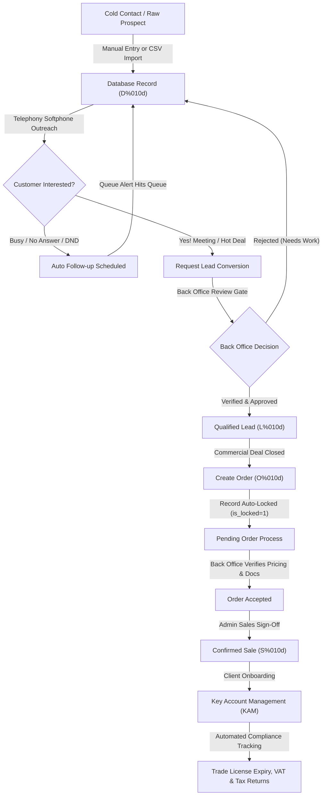

<div align="center">

# Seven Strokes CRM (v2)

### The no-nonsense commercial ops, softphone dialer & key account management powerhouse.

[](https://www.php.net/)
[](https://codeigniter.com/)
[](https://www.mysql.com/)
[](#copyright--can-you-claim-this-crm)
[](#design-vibe--apple-style-rules)
[](#cpanel-hosting-guide-step-by-step)

<br/>

**Seven Strokes CRM** is an all-in-one operations platform built for fast-moving sales reps, back office gatekeepers, key account managers (KAM), and executives. 

Old CRMs usually feel like using software from 2004—bulky boxes, neon rainbow buttons, and loading spinners that take forever. We scrapped all that bloat. This CRM looks like a clean Apple desktop app, runs buttery smooth on any regular cPanel hosting, dials prospects straight from your browser, and keeps raw leads strictly separated from approved money-making sales.

</div>

---

## Quick Navigation

- [Why We Built This (The Real Story)](#why-we-built-this-the-real-story)
- [System Architecture & Workflow](#system-architecture--workflow)
- [How Much Code Actually Changed? (Stats)](#how-much-code-actually-changed-stats)
- [Feature Breakdown: What's In The Box](#feature-breakdown-whats-in-the-box)
- [Security: Environment (.env) & Zero Secrets](#security-environment-env--zero-secrets)
- [Database Migrations (The Modern Way)](#database-migrations-the-modern-way)
- [cPanel Hosting Guide (Step-by-Step)](#cpanel-hosting-guide-step-by-step)
- [Troubleshooting & Gotchas](#troubleshooting--gotchas)
- [Copyright: Can You Claim This CRM?](#copyright--can-you-claim-this-crm)

---

## Why We Built This (The Real Story)

Most legacy CRMs have two massive headaches:
1. **Sales reps mess up client data**: A rep edits a client name mid-order, changes the price on a whim, or marks a cold lead as "Sale Won" before anyone verified payment. Pure chaos.
2. **Servers crawl on their knees**: The old database was doing over **400 unindexed SQL queries** just to render the dashboard once. On shared cPanel hosting, that felt like dial-up internet.

We fixed both:
- **Strict Entity Separation**: A record starts as a cold Database row (`D0000000001`). Once verified, it becomes a Lead (`L0000000001`). Once an order is submitted, the record gets **locked immediately** (`is_locked=1`) so reps can't alter prices behind your back. Only Back Office and Admins can approve it into a confirmed Sale (`S0000000001`).
- **Performance That Hits Different**: Added composite indexes on every heavy foreign key, cached team lookups in memory, and throttled session writes. The dashboard now loads instantly without melting your server CPU.

---

## System Architecture & Workflow

Here is the exact lifecycle of how data flows through Seven Strokes CRM—from cold calling to renewal contracts:



---

## How Much Code Actually Changed? (Stats)

We didn't just tweak a few colors. We overhauled the entire codebase from the ground up compared to the initial legacy base commit (`d5d67fd`):

```
========================================================================================
SEVEN STROKES CRM - QUANTITATIVE EVOLUTION AUDIT
Baseline: Initial Commit (d5d67fd)  -->  Current Enterprise v2 (HEAD)
========================================================================================
Files Created / Updated      : 177 files
Total Added Lines            : +91,267 lines
Total Removed Lines          : -6,987 lines
----------------------------------------------------------------------------------------
NET CODE ADDED               : +84,280 lines
Total Added Words            : +641,059 words
Total Removed Words          : -18,212 words
----------------------------------------------------------------------------------------
NET WORDS ADDED              : +622,847 words
Total Added Characters       : +5,690,960 chars
Total Removed Characters     : -255,270 chars
----------------------------------------------------------------------------------------
NET CHARACTERS ADDED         : +5,435,690 chars
Total Alphabets (Letters)    : +2,655,328 letters (+2,782,220 inserted / -126,892 removed)
========================================================================================
```

---

## Feature Breakdown: What's In The Box

### 1. Executive Dashboard (No Clutter, All Signal)
- **Top 8 KPI Cards**: Instant counts for My Database, My Verticals, Team Users, Team Verticals, Leads, and Orders styled in Royal Blue (`#0072f0`). The whole card is clickable.
- **12-Month Projections**: Clean line charts showing Target vs Achievement and Target vs Projection across a full 12-month rolling window.
- **Apple-Style Donut Charts**: Crisp, high-res SVG circular charts for **My Leads** and **My Orders**. Big bold donut rings (196px diameter), high-contrast status percentages, and clear outside text labels.
- **Operational Activity Grid**: Live cards for tickets, tasks, follow-ups, and meetings.

### 2. My Zone (Your Daily Grind)
- **Add & View Database**: Quick prospect entry with dual-box table filtering.
- **View Leads**: Pipeline status view for verified leads.
- **View Orders (`manager/orders/my`)**: View-only personal order tracker. No sneaky post-submission editing.
- **View Sales**: Verified revenue wins.
- **My Follow-ups & Meetings**: Smart calendar tracking today's calls, missed follow-ups, and future bookings.

### 3. Team Management & Org Chart
- **Interactive Tree Hierarchy**: Sleek tree diagram letting team leaders drill up to their direct manager or expand downwards into sub-teams with smooth zoom controls.
- **Team Activity Tracker**: Live feed of what your sales reps are actually doing (leads worked, calls logged, deals closed).
- **Database Bulk Assignment**: Rebalance lead distribution across sales reps with one click.

### 4. Back Office Gatekeeper
- **Pending Leads Approval (`manager/leads/review_leads`)**: Quality gate to make sure reps only promote legitimate, verified prospects to Leads.
- **Pending Order Process (`manager/orders/pending_process`)**: Finance and ops audit trade licenses, pricing, and contract documents before orders go live.
- **Onboard Client (`manager/kam/onboard`)**: Smooth handoff to account managers with corporate legal profiles, Emirates, and jurisdiction details.

### 5. WebRTC Phone Dialer & Telephony
- **Cross-Device Ready**: Adapts smoothly from mobile touchscreens to desktop widescreen monitors.
- **4-Stage Smart Calling Queues**:
  1. Last 7 Days (Missed/Overdue)
  2. Today (Active targets)
  3. Next 7 Days (Upcoming bookings)
  4. All Future
- **Real Call Durations**: Zero fake connected timers. Timers only tick when the call is genuinely connected. Includes instant call note saving and optional Groq AI call summaries.

### 6. Live Operations Pivot Board
- **Spreadsheet-Style Pivot Sheet**: Compact table showing My Stats, Team Stats, and Leaderboards.
- **Color Coded Windows**: Today (Emerald), Last 7 Days (Amber), This Month (Blue), This Quarter (Purple).
- **Background Sync**: Silently fetches live stats every 10 seconds without annoying page refreshes.
- **TV Presentation Mode**: Dedicated full-screen layout designed for sales floor TV displays.

### 7. Key Account Management (KAM)
- Track trade license renewal dates, corporate tax filing deadlines, and VAT submission schedules so you never get hit with government fines.

### 8. HR Operations & GPS Geofencing
- Staff attendance tracking with GPS geofenced check-in boundaries, leave management, shift allocations, and payroll logs.

---

## Security: Environment (.env) & Zero Secrets

Hardcoding database passwords or database names directly into git repositories is a massive security risk. We moved all sensitive credentials to `.env`.

### 1. The `.env.example` Template
A sample template is provided in the repository root ([`.env.example`](file:///c:/Users/SRJ%20feb/Downloads/softwares/CRM/2026.10.08-1%20-%20crm.rolextogroup.com/crm.rolextogroup.com/.env.example)):

```bash
# Database Configuration
DB_HOST=localhost
DB_PORT=3306
DB_NAME=crm7strokes
DB_USER=root
DB_PASS=

# Base URL & Environment
BASE_URL=https://crm.7strokes.com/
CI_ENV=production

# Optional Integrations
GROQ_API_KEY=
PBX_ENDPOINT=
```

### 2. How to Set Up Your `.env`
1. On your cPanel or server, copy the template:
   ```bash
   cp .env.example .env
   ```
2. Open `.env` and fill in your actual cPanel database credentials:
   - **`DB_NAME`**: Found in cPanel > MySQL Databases (e.g. `cpaneluser_crm7strokes`).
   - **`DB_USER`**: The MySQL user you assigned to the database (e.g. `cpaneluser_crmuser`).
   - **`DB_PASS`**: The password you set for that database user.
   - **`DB_HOST`**: Almost always `localhost` on cPanel.
   - **`BASE_URL`**: Your full CRM URL (e.g. `https://crm.7strokes.com/`).
   - **`CI_ENV`**: Set to `production` on live hosting (turns off PHP warning popups) or `development` on your local laptop.
3. `.env` is permanently ignored by `.gitignore`, keeping your passwords safe.

---

## Database Migrations (The Modern Way)

Forget manually importing random SQL snippets into phpMyAdmin whenever new features ship. Seven Strokes CRM has a built-in versioned migration runner.

All migrations live in [`application/migrations/`](file:///c:/Users/SRJ%20feb/Downloads/softwares/CRM/2026.10.08-1%20-%20crm.rolextogroup.com/crm.rolextogroup.com/application/migrations) and track their status in the `schema_migrations` table:

```bash
# 1. Check which migrations are pending or already applied
php migration_runner.php status

# 2. Run all pending migrations with execution timings
php migration_runner.php

# 3. Rollback the most recent batch if needed
php migration_runner.php rollback
```

### Migrations Included in v2

| Migration | What it does |
|---|---|
| `001_core_crm_schema.php` | Creates `ci_tasks`, `ci_admin_logs`, extended `ci_tickets` columns, business categories |
| `002_ticket_history_and_followups.php` | Ticket history audit logs & follow-up queues |
| `003_user_security_and_currency.php` | User session tokens, IP logs, online indicators, custom user currency |
| `004_lead_quote_and_trn.php` | Quotes, Corporate Tax TRN, VAT TRN, data sources, database categories |
| `005_finance_and_operations.php` | Invoices, payments, expenses, service delivery, attendance, leaves |
| `006_orders_and_sales_approval.php` | Order approval fields, sales conversion referral tracker, lead locking |
| `007_performance_indexes.php` | Multi-column database indexes across `ci_leads`, `ci_user`, `ci_orders`, `ci_tasks`, `ci_tickets` |

---

## cPanel Hosting Guide (Step-by-Step)

Here is how to get this running on cPanel in under 10 minutes:

### Step 1: Check Your PHP Version
1. Log into your cPanel account.
2. Go to **Software** > **MultiPHP Manager**.
3. Select your domain (`crm.7strokes.com`) and choose **PHP 7.4**, **PHP 8.0**, **PHP 8.1**, or **PHP 8.2**.
4. In **MultiPHP INI Editor**, set:
   - `memory_limit = 256M`
   - `max_input_vars = 5000` (Crucial for large role permission matrices!)
   - `upload_max_filesize = 64M`

### Step 2: Create Your Database
1. In cPanel, go to **Databases** > **MySQL Databases**.
2. Create a new database named `crm7strokes` (your full name will look like `yourcpaneluser_crm7strokes`).
3. Create a database user with a strong password.
4. Under **Add User To Database**, add your user to the database and select **ALL PRIVILEGES**.

### Step 3: Upload the Code
1. In cPanel, open **File Manager** and go to your site directory (e.g. `public_html/` or your subdomain folder).
2. Upload the project zip and extract it.
3. Make sure `.htaccess` is present (click **Settings** at the top-right of File Manager and check **Show Hidden Files**).

### Step 4: Setup Your `.env` File
1. In File Manager, copy `.env.example` to `.env`.
2. Edit `.env` with your database name, user, password, and URL:
   ```env
   DB_HOST=localhost
   DB_NAME=yourcpaneluser_crm7strokes
   DB_USER=yourcpaneluser_crmuser
   DB_PASS=YourStrongPasswordHere
   BASE_URL=https://crm.7strokes.com/
   CI_ENV=production
   ```

### Step 5: Import Base Database & Run Migrations
1. Open **phpMyAdmin** from cPanel and select your database.
2. Click **Import**, choose [`database/localhost.sql`](file:///c:/Users/SRJ%20feb/Downloads/softwares/CRM/2026.10.08-1%20-%20crm.rolextogroup.com/crm.rolextogroup.com/database/localhost.sql), and hit **Go**.  
   *(Notice: All old hardcoded rolexto references and database names have been completely removed, so it will import smoothly without any `#1044 Access Denied` errors).*
3. Open **Terminal** in cPanel (or SSH) inside your CRM folder and run:
   ```bash
   php migration_runner.php
   ```
   *This applies all latest tables, fields, and performance indexes in seconds.*

### Step 6: Verify Permissions
Make sure folders have standard permissions:
- Regular folders: `0755`
- Files: `0644`
- Writable folders:
  - `application/cache/` -> `0755`
  - `application/logs/` -> `0755`
  - `assets/uploads/` -> `0755`

### Step 7: Turn On SSL & Force HTTPS
1. In cPanel, go to **SSL/TLS Status**, select your domain, and click **Run AutoSSL**.
2. Once the green lock appears, go to **Domains** > **Domains** and switch **Force HTTPS Redirect** to **ON**.

### Step 8: Setup Background Cron Job
To keep auto follow-up alerts, reminders, and background syncs ticking:
1. In cPanel, open **Cron Jobs**.
2. Add a new cron job running every minute (`* * * * *`):
   ```bash
   /usr/local/bin/php /home/yourcpaneluser/public_html/index.php ci_cron run >/dev/null 2>&1
   ```
   *(Replace `/home/yourcpaneluser/public_html/` with your actual server path).*

---

## Troubleshooting & Gotchas

| Issue | What's actually happening | How to fix it |
|---|---|---|
| **404 on internal links** | `.htaccess` is missing or Apache mod_rewrite is off | Make sure `.htaccess` was uploaded (enable hidden files in File Manager). Check that `RewriteRule ^(.*)$ index.php?/$1 [L]` is inside. |
| **Database Connection Error** | Missing cPanel user prefix or wrong password | Check `.env`. In cPanel, database names always include your username prefix (e.g. `user_crm7strokes`, not just `crm7strokes`). |
| **Pages taking 5+ seconds to load** | Missing database indexes | Run `php migration_runner.php` to apply Migration `007`. Indexes turn table-scans into instant index lookups. |
| **Instant logout right after login** | Cookie domain mismatch | Make sure `$config['cookie_domain'] = '';` in `config.php` and verify `application/cache/` is writable (`0755`). |
| **Saving permissions cuts off half the inputs** | PHP POST variable limit reached | In cPanel **MultiPHP INI Editor**, bump `max_input_vars` from `1000` to `5000`. The role permission matrix has hundreds of check fields. |

---

## Copyright: Can You Claim This CRM?

### Straight Answer: Yes, 100%.

Here is the exact legal breakdown under software licensing law:

1. **The Framework (CodeIgniter)**: The underlying framework in `system/` is open-source under the **MIT License**. The MIT License is one of the most permissive licenses in software engineering: it allows anyone to take the framework, build commercial closed-source software on top of it, sell it, modify it, and relicense the application layer.
2. **Your Application Layer**: All custom controllers, models, views, business workflows, dialer logic, custom stylesheets, database schemas, and documentation created for **Seven Strokes CRM** are 100% bespoke proprietary intellectual property.
3. **Old License Removed**: The generic `license.txt` in the root folder (which was the old default CodeIgniter template) has been removed. The standard CodeIgniter framework notice remains inside `system/` as required by MIT terms.
4. **Your Copyright**: You can legally claim full proprietary ownership:

```
Copyright (c) 2026 Seven Strokes CRM Platform. All rights reserved.

Proprietary commercial software. Unauthorized copying, modification,
distribution, or decompilation is strictly prohibited.
```

---

<div align="center">
  <sub>Seven Strokes CRM v2 • Built for clean code, high speed, and serious sales operations.</sub>
</div>
