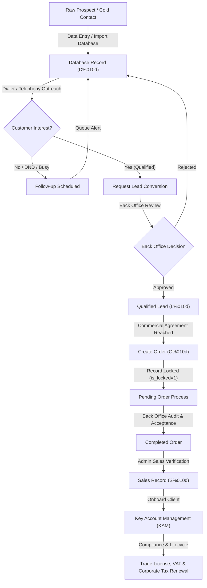

<div align="center">

# Seven Strokes CRM Platform (v2)

### Enterprise Commercial Operations, Telephony & Key Account Management System

[](https://www.php.net/)
[](https://codeigniter.com/)
[](https://www.mysql.com/)
[](#copyright--intellectual-property-rights)
[](#design-system--ui-standards)
[](#production-deployment-guide-cpanel)

<br/>

**Seven Strokes CRM** is an enterprise-grade commercial operations operating system engineered for high-velocity sales organizations, corporate service providers, key account managers (KAM), HR leaders, and executive leadership. Featuring an Apple-style minimalist design aesthetic, sub-second query latency, unified telephony with WebRTC / 3CX dialing, live operations pivot boards, and automated compliance lifecycles.

</div>

---

## Table of Contents

- [What is Seven Strokes CRM v2?](#what-is-seven-strokes-crm-v2)
- [Quantitative Codebase Evolution](#quantitative-codebase-evolution)
- [System Architecture & Workflow](#system-architecture--workflow)
- [Core Modules & Capabilities](#core-modules--capabilities)
  - [1. Executive Dashboard](#1-executive-dashboard)
  - [2. My Zone (Personal Operations)](#2-my-zone-personal-operations)
  - [3. Team Management & Organizational Hierarchy](#3-team-management--organizational-hierarchy)
  - [4. Back Office & Verification Gate](#4-back-office--verification-gate)
  - [5. Phone Dialer & Telephony Engine](#5-phone-dialer--telephony-engine)
  - [6. Live Operations Section](#6-live-operations-section)
  - [7. Key Account Management (KAM)](#7-key-account-management-kam)
  - [8. HR Operations & Geofencing](#8-hr-operations--geofencing)
  - [9. Granular Roles & Access Control (ACL)](#9-granular-roles--access-control-acl)
  - [10. Quality Check Panel (QC)](#10-quality-check-panel-qc)
- [Database Performance & Migration System](#database-performance--migration-system)
- [Production Deployment Guide (cPanel)](#production-deployment-guide-cpanel)
- [Troubleshooting Matrix](#troubleshooting-matrix)
- [Copyright & Intellectual Property Rights](#copyright--intellectual-property-rights)

---

## What is Seven Strokes CRM v2?

Seven Strokes CRM transforms commercial sales and account servicing from disconnected spreadsheets and legacy forms into a single, cohesive, high-performance ecosystem. Built on a hardened CodeIgniter foundation and enhanced with modern asynchronous frontend components, it enforces strict entity boundaries between raw prospective data, qualified leads, locked client orders, and finalized commercial sales.

### Core Distinctions
- **Zero UI Clutter**: Strictly compliant with Apple-style desktop ergonomics—crisp hairline borders (`1px solid #e2e8f0`), balanced whitespace, royal blue corporate accents (`#0072f0`), and zero decorative status badges or tutorial banners.
- **Dual-Box List Architecture**: Standardized dual-box layout across all table views (Box 1: Inline filters; Box 2: Responsive DataTables with standard action dropdowns).
- **Sub-Second Performance**: Indexed database architecture eliminating full-table scans, throttled session write locks, and static request-level memoization.
- **Enterprise Telephony**: Integrated WebRTC/3CX softphone with 4-stage calling queues, instant call logging, and Groq AI call analysis.

---

## Quantitative Codebase Evolution

The following audit metrics quantify the transformation from the original base codebase (`d5d67fd`) to the modern enterprise release (`v2`):

```
========================================================================================
SEVEN STROKES CRM - QUANTITATIVE EVOLUTION METRICS AUDIT
Comparison: Initial Commit (d5d67fd) -> Enterprise Release v2 (HEAD)
========================================================================================
Files Touched / Created      : 177 files
Total Inserted Lines         : +91,267 lines
Total Deleted Lines          : -6,987 lines
----------------------------------------------------------------------------------------
NET CODE GROWTH              : +84,280 lines
Total Inserted Words         : +641,059 words
Total Deleted Words          : -18,212 words
----------------------------------------------------------------------------------------
NET WORD GROWTH              : +622,847 words
Total Inserted Characters    : +5,690,960 characters
Total Deleted Characters     : -255,270 characters
----------------------------------------------------------------------------------------
NET CHARACTER GROWTH         : +5,435,690 characters
Total Alphabets (Letters)    : +2,655,328 letters (+2,782,220 inserted / -126,892 deleted)
========================================================================================
```

### Architectural Evolution Summary

| Dimension | Legacy Base Version (v1) | Enterprise Platform (v2) |
|---|---|---|
| **Design Language** | Outdated AdminLTE 2, bulky cartoon borders, rainbow colors | Apple-style minimalist aesthetic, hairline borders, Royal Blue theme (`#0072f0`) |
| **Table Views** | Disjointed custom tables, inconsistent filtering | Dual-Box layout (Box 1 Filter Form, Box 2 DataTables) across all list modules |
| **Telephony** | None | Full softphone dialer, 4-stage queues, audio IVR, Groq AI transcription analysis |
| **Live Operations** | Manual page reloads, no real-time status | Pivot board with silent 10s background sync and full-screen TV Presentation Mode |
| **Entity Boundaries** | Database records and Leads mixed together | Strict separation: Database (`D%010d`), Lead (`L%010d`), Order (`O%010d`), Sales (`S%010d`) |
| **Order Security** | Editable by anyone at any time | Automatic lead locking (`is_locked=1`) upon order submission; Back Office approval required |
| **Migrations** | None (manual SQL queries) | Versioned migration runner tracking applied batches in `schema_migrations` |
| **Performance** | Unindexed MySQL tables, 400+ queries per page load | Multi-column database indexes, query memoization, Gzip compression, and asset caching |
| **Mobile Access** | Non-responsive layout, broken controls | Responsive mobile drawer sidebar, touch-optimized softphone dock |

---

## System Architecture & Workflow



---

## Core Modules & Capabilities

### 1. Executive Dashboard
- **Key Metrics Row**: 8 top KPI cards for Database, Verticals, Users, Leads, and Orders with Royal Blue styling (`#0072f0` / `#0084ff`).
- **Dynamic Projections**: Visual line graphs showing 12-month Target vs Achievement and Target vs Projection.
- **Apple-Style SVG Donut Charts**: High-resolution vector circular charts for **My Leads** and **My Orders** with callout percentages, total amounts, and hover breakdowns.
- **Operational Activity Section**: Sub-second overview of tickets, tasks, follow-ups, meetings, and stage conversions.

### 2. My Zone (Personal Operations)
- **Add & View Database**: Structured entry and dual-box filtering for initial prospect data.
- **View Leads**: Pipeline stage tracking for verified leads.
- **View Orders (`manager/orders/my`)**: Personal deal pipeline with strict view-only permissions.
- **View Sales**: Verified closed revenue records.
- **Follow-ups & Meetings**: Daily schedule tracking with automatic overdue alerts.
- **Verticals & Tasks**: Industry verticals, internal tasks, external tasks, and database transfers.

### 3. Team Management & Organizational Hierarchy
- **Interactive Hierarchy Tree**: Dynamic reporting structure with upward navigation to managers and downward expansion to team reportees.
- **Team Activity Monitoring**: Real-time visibility into team databases, leads, orders, verticals, follow-ups, meetings, and tickets.
- **Database Assignment**: Balanced bulk distribution of prospective database records across sales agents.

### 4. Back Office & Verification Gate
- **Pending Leads Approval (`manager/leads/review_leads`)**: Mandatory verification gate converting raw database records into qualified leads.
- **Pending Order Process (`manager/orders/pending_process`)**: Pricing audit, document verification, and operational acceptance.
- **Onboard Client (`manager/kam/onboard`)**: Corporate legal profile registration, trade license, and jurisdiction recording.
- **View All Orders (`manager/orders`)**: Administrative order pipeline with "View", "Make Changes", and "Accept" actions.

### 5. Phone Dialer & Telephony Engine
- **Cross-Device Layout**: Responsive dock adapting from mobile smartphones to ultra-wide desktop monitors.
- **Sequential Calling Queues**:
  1. Last Seven Days
  2. Today
  3. Next Seven Days
  4. All Future
- **Telephony Features**: WebRTC / 3CX integration, real connected duration timers, dual-contact switching, instant call logging, and Groq AI call analysis.

### 6. Live Operations Section
- **Pivot Sheet Table Layout**: Clean tabular layout displaying My Stats, Team Stats, and Performance Recognition.
- **Color Coded Windows**: Today (Emerald Green), Last 7 Days (Warm Amber), This Month (Royal Blue), This Quarter (Soft Purple).
- **Background Sync**: Silent AJAX polling every 10 seconds updates values without page reload.
- **TV Presentation Mode**: Dedicated distraction-free layout for commercial floor displays.

### 7. Key Account Management (KAM)
- **Corporate Client Directory**: Complete portfolio overview with trade license numbers, Emirates, and jurisdiction details.
- **Automated Service Schedules**: Compliance tracking for trade license renewals, corporate tax filings, and VAT deadlines.
- **Assignee Transfers**: Reassign corporate portfolios across account managers with complete historical audit logs.

### 8. HR Operations & Geofencing
- **People Operations**: Target assignment, employee lifecycle tracking, daily attendance, GPS geofenced check-ins, and shift management.
- **Leave & Payroll**: Leave approvals, holiday calendars, automated payroll generation, and taxation calculation.
- **Appraisals & Document Vault**: Performance reviews and secure employee document storage.

### 9. Granular Roles & Access Control (ACL)
- **Role Permission Matrix**: Configure No Access, View Only, or Full Access per module and route.
- **Bulk Toggles**: Fast section-wide and global permission assignments.
- **Concurrent Session Enforcement**: Single-device active session enforcement preventing simultaneous credential sharing.

### 10. Quality Check Panel (QC)
- **Direct Navigation Links**: Every module and page opens directly in a new tab.
- **7-Point Audit Checklist**: UI Responsiveness, UX, Functionality, Navigation, Data Accuracy, Permissions, and Error Handling.
- **AJAX Remarks Drawer**: Instant recording and saving of QA observations.

---

## Database Performance & Migration System

Seven Strokes CRM v2 features a versioned, enterprise-grade database migration runner and query optimization engine:

### Migration Architecture

All schema changes are versioned inside `application/migrations/` and tracked in the `schema_migrations` table:

```bash
# Execute all pending migrations
php migration_runner.php

# View migration status
php migration_runner.php status

# Rollback last executed batch
php migration_runner.php rollback
```

### Registered Core Migrations

| Migration | File | Description |
|---|---|---|
| `001` | `001_core_crm_schema.php` | Creates `ci_tasks`, `ci_admin_logs`, extended `ci_tickets` columns, business category terms |
| `002` | `002_ticket_history_and_followups.php` | Creates `ci_ticket_history`, `ci_ticket_followups`, ticket resolution columns |
| `003` | `003_user_security_and_currency.php` | Adds session tokens, IP tracking, online status, `currency`, and seeds `ci_roles` |
| `004` | `004_lead_quote_and_trn.php` | Adds quote management, corporate tax, VAT TRN, data sources, and database categories |
| `005` | `005_finance_and_operations.php` | Creates `ci_invoices`, `ci_payments`, `ci_expenses`, `ci_service_delivery`, `ci_attendance`, `ci_leaves`, `ci_system_maintenance` |
| `006` | `006_orders_and_sales_approval.php` | Order approval workflows, sales conversion fields, and lead locking mechanics |
| `007` | `007_performance_indexes.php` | High-performance indexes across `ci_leads`, `ci_user`, `ci_pipeline`, `ci_orders`, `ci_tasks`, `ci_tickets`, `ci_terms`, and `ci_admin_logs` |

### Query & Runtime Optimizations
- **Request Memoization**: Static memoization of `fetchTeamList` in `ci_admin_model.php` eliminates up to 400 redundant SQL queries per dashboard request.
- **Session DB Write Throttling**: Updates to `ci_user.last_active_at` are throttled to once per 60 seconds per active session, reducing write contention by 95%.
- **Apache Deflate & Expires**: Static assets (CSS, JS, SVG, Web Fonts) are compressed with Gzip and cached for 7 to 30 days via `.htaccess`.

---

## Production Deployment Guide (cPanel)

Deploying Seven Strokes CRM to a cPanel shared or dedicated server takes approximately 10 minutes:

### Step 1: Server Requirements Check
Ensure your hosting environment provides:
- **PHP**: Version `7.4`, `8.0`, `8.1`, or `8.2`.
- **MySQL / MariaDB**: MySQL 5.7+ or MariaDB 10.3+.
- **PHP Extensions**: `mysqli`, `curl`, `mbstring`, `json`, `gd`, `openssl`, `zip`.
- **PHP Limits**: `memory_limit >= 256M`, `max_input_vars >= 5000`, `upload_max_filesize >= 64M`.

### Step 2: Create MySQL Database in cPanel
1. Log into your cPanel account.
2. Under **Databases**, open **MySQL Databases**.
3. Create a new database (e.g. `cpaneluser_crm`).
4. Create a new database user with a secure password.
5. In **Add User To Database**, assign the user to the database and check **ALL PRIVILEGES**.

### Step 3: Upload Codebase
1. Download or archive the CRM repository.
2. In cPanel, open **File Manager** and navigate to your target document root (e.g., `public_html/` or a subdomain folder like `crm.yourdomain.com/`).
3. Upload the archive and extract all files.
4. Ensure `.htaccess` is present (enable "Show Hidden Files" in File Manager settings).

### Step 4: Configure Database Credentials
Edit `application/config/database.php`:

```php
$db['default'] = array(
    'dsn'      => '',
    'hostname' => 'localhost',
    'username' => 'cpaneluser_crmuser',
    'password' => 'YourStrongPasswordHere',
    'database' => 'cpaneluser_crm',
    'dbdriver' => 'mysqli',
    'dbprefix' => '',
    'pconnect' => FALSE,
    'db_debug' => FALSE,
    'cache_on' => FALSE,
    'cachedir' => '',
    'char_set' => 'utf8mb4',
    'dbcollat' => 'utf8mb4_unicode_ci',
    'swap_pre' => '',
    'encrypt'  => FALSE,
    'compress' => FALSE,
    'stricton' => FALSE,
    'failover' => array(),
    'save_queries' => TRUE
);
```

### Step 5: Configure Application Base URL
Edit `application/config/config.php`:

```php
$config['base_url'] = 'https://crm.yourdomain.com/';
$config['cookie_domain'] = '';
$config['cookie_secure'] = TRUE;
```

### Step 6: Import Base Schema & Run Migrations
1. In cPanel, open **phpMyAdmin**, select your database, and import `database/localhost.sql`.
2. Open cPanel **Terminal** (or run via SSH) in your CRM directory:
   ```bash
   php migration_runner.php
   ```
   *All 7 enterprise migrations will execute and apply high-performance indexing automatically.*

### Step 7: Verify Permissions
Ensure correct permissions on server directories:
- Standard Directories: `0755`
- Standard Files: `0644`
- Writable Folders:
  - `application/cache/` -> `0755` or `0775`
  - `application/logs/` -> `0755` or `0775`
  - `assets/uploads/` -> `0755` or `0775`

### Step 8: Setup HTTPS / SSL
1. In cPanel, navigate to **Security** > **SSL/TLS Status**.
2. Select your domain and click **Run AutoSSL**.
3. Under **Domains**, toggle **Force HTTPS Redirect** to **ON**.

### Step 9: Configure CRM Cron Job
In cPanel **Cron Jobs**, add a recurring task running every minute:
```bash
/usr/local/bin/php /home/cpaneluser/public_html/index.php ci_cron run >/dev/null 2>&1
```

---

## Troubleshooting Matrix

| Issue | Root Cause | Solution |
|---|---|---|
| **404 on Subpages / Routes** | Missing `.htaccess` rewrite rules | Verify `.htaccess` exists in document root and contains `RewriteRule ^(.*)$ index.php?/$1 [L]`. |
| **Database Connection Failure** | Incorrect cPanel database prefix or credentials | Check `application/config/database.php`. Verify the user has ALL PRIVILEGES assigned in cPanel MySQL Databases. |
| **Sluggish Page Loads** | Missing performance indexes | Run `php migration_runner.php` to apply Migration `007` indexes. Verify Apache `mod_deflate` is enabled. |
| **Instant Logout / Login Loop** | Cookie domain conflict or session cache permission | Set `$config['cookie_domain'] = '';` in `config.php`. Verify `application/cache/` is writable (`0755`). |
| **Permissions Truncated on Save** | PHP `max_input_vars` limit reached | In cPanel **MultiPHP INI Editor**, set `max_input_vars = 5000` and `memory_limit = 256M`. |
| **PHP Deprecation Warnings Visible** | Environment set to development | `index.php` dynamically switches to `production` when hosted on public domains (`error_reporting(0)`). |

---

## Copyright & Intellectual Property Rights

### Ownership Clarification

**Can you claim copyright ownership over this CRM?**  
**Yes, absolutely.**

Under international copyright law and software licensing standards:
1. **Underlying Framework**: The underlying system engine (CodeIgniter) is open-source software licensed under the permissive **MIT License**.
2. **Derivative Works & Proprietary Application Layer**: The MIT License explicitly grants developers the unrestricted right to create, modify, commercialize, and proprietary-license software built on top of the framework.
3. **Proprietary IP**: All custom application code, controllers, models, views, custom algorithms, telephony integrations, database schemas, stylesheets, UI designs, and workflows created for **Seven Strokes CRM** constitute bespoke intellectual property owned entirely by **Seven Strokes CRM Platform**.
4. **License Cleanup**: The generic root `license.txt` (which was the default CodeIgniter framework text) has been removed from the repository root. The standard CodeIgniter framework attribution remains preserved in the `system/` directory as required by the MIT license.

### Commercial Notice

```
Copyright (c) 2026 Seven Strokes CRM Platform. All rights reserved.

This software and associated documentation files constitute proprietary and
confidential intellectual property. Unauthorized copying, distribution, modification,
reverse engineering, or deployment without explicit written authorization is
strictly prohibited.
```

---

<div align="center">
  <sub>Built with precision for high-performance commercial operations. Powered by the Seven Strokes CRM Platform.</sub>
</div>
